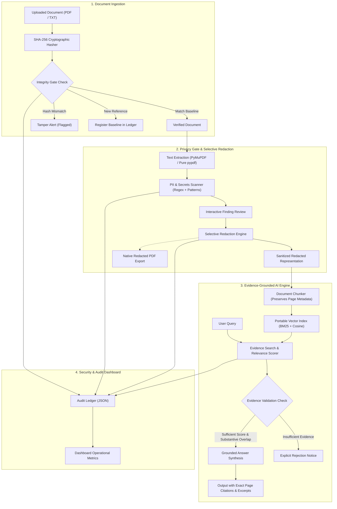

# TrustLens Architecture: Privacy-Gated AI with Verifiable Evidence

**Theme:** AI Secured: Innovation Without Exposure  
**Target Platform:** IBM LinuxONE (s390x) & Enterprise Hybrid Cloud  
**Competition:** IBM Z Datathon 2026  

---

## 1. Executive Summary

Enterprise document intelligence faces three critical risks when utilizing Generative AI:
1. **Accidental Exposure of Sensitive Data (PII/Secrets):** Sending confidential customer information, credentials, or proprietary identifiers to third-party or even internal LLMs.
2. **AI Hallucinations and Fabricated Citations:** Models generating plausible-sounding answers with fabricated quotes or page numbers.
3. **Silent Document Tampering:** Ingesting modified or compromised documents without cryptographic verification against a baseline.

**TrustLens** solves this through a zero-trust, multi-tiered pipeline:
- **Cryptographic Document Integrity Gate:** Computes SHA-256 digests from raw bytes, registering trusted references and flagging unauthorized modifications.
- **Privacy Gate & Redaction Engine:** Automatically scans and detects PII, secrets, and financial identifiers; isolates sensitive values, and guarantees that only human-approved sanitized representations enter the AI pipeline.
- **Evidence-Grounded RAG:** Uses a portable, s390x-compatible retrieval-augmented generation engine that answers questions strictly using verifiable excerpts with exact page citations, and explicitly rejects unsupported queries.
- **Tamper-Evident Audit Ledger:** Maintains an immutable chronological log of all ingestion, integrity checks, redactions, and queries with real operational metrics.

---

## 2. System Architecture Diagram

---

## 3. Component Deep Dive

### A. Document Integrity Gate (`integrity.py`)
- Computes SHA-256 digests over raw byte streams prior to any parsing.
- Maintains a reference ledger (`data/integrity_ledger.json`).
- Compares new uploads against stored baselines:
  - `MATCH`: Document is verified identical at the byte level.
  - `MODIFIED`: Byte differences detected; warning surfaced immediately.
  - `NOT_REGISTERED`: Baseline cataloged for future audit.
- *Security Reality Check:* Cryptographic hashing verifies bitwise consistency relative to a reference; it does not independently prove human authorship.

### B. Privacy Gate & Redaction (`privacy.py`)
- Employs resilient dual PDF engines:
  - PyMuPDF (`fitz`) when native C++ runtimes are present.
  - Pure-Python `pypdf` for guaranteed zero-failure execution on IBM LinuxONE (`s390x`).
- Scans for 6 classes of sensitive entities:
  1. Emails (`alice@domain.com`)
  2. Phone Numbers (US, international, Indian standard formats)
  3. Credit Cards (Visa, MasterCard, Amex, Discover)
  4. Social Security Numbers / Tax IDs (`XXX-XX-XXXX`)
  5. API Keys, Access Tokens, and Secrets (`sk-...`, Bearer tokens)
  6. IP Addresses (IPv4 standard blocks)
- User can selectively toggle redactions or apply batch redaction.
- **Strict Pipeline Isolation:** The raw document text is segregated in memory; the AI embedding and QA engine can access ONLY the approved redacted text.

### C. Evidence-Grounded RAG Pipeline (`document_qa.py`)
- Chunking algorithm splits pages while preserving exact page numbers:
  - Pages are never blended across boundaries.
  - Chunks retain `chunk_id`, `page`, and `source_filename`.
- **Portable Vector Retrieval:** Uses pure Python + NumPy BM25 term weighting:
  - Zero heavy compiled C++ dependencies that fail on Big Endian `s390x`.
  - Sublinear term frequency scaling and inverse document frequency.
  - Automatic English stopword filtering to isolate substantive query concepts.
- **Strict Evidence Validation:**
  - If substantive query terms have zero match or relevance score is below threshold:
    Refuses to speculate. Outputs: *"The document does not contain sufficient verifiable evidence to answer this question."*
  - If evidence is present:
    Synthesizes facts derived exclusively from the retrieved chunks, formatting exact citations (e.g. `[Page 2]`) and verbatim supporting passages.
- **Prompt Injection Defense:** External document passages are framed strictly within `<untrusted_document_context>` delimiters with system instructions to ignore injected command directives.
- **Mocked Model Prompt Inspection:** DocumentQAPipeline supports pluggable model invokers; verified that model inputs contain zero unmasked sensitive PII.

### D. Security Auditor (`audit.py`)
- Logs timestamped events in UTC ISO format:
  `DOCUMENT_INGESTED`, `PRIVACY_SCAN`, `REDACTION_APPLIED`, `INTEGRITY_CHECK`, `QA_QUERY`.
- Real metric calculation: calculates true counts and real measured latency in milliseconds.
- Exports full verifiable audit log in standard JSON format.
- Zero sensitive data logging: only records metadata, categories, hashes, and latencies.

### E. Role-Based Access Control (RBAC) (`config.py` & `app.py`)
- **Security Officer:** Full administrative authority (baseline registration, redaction approvals, sanitized PDF downloads, audit trail export).
- **Compliance Auditor:** Independent oversight (integrity verification against baselines, audit ledger inspection, JSON export; restricted from altering redactions).
- **Restricted Viewer:** Read-only access (Security Dashboard metrics, evidence-grounded Q&A queries against locked documents only).

---

## 4. IBM LinuxONE (s390x) Portability Architecture

| Layer | Standard x86_64 Stack | TrustLens LinuxONE Architecture | Benefit on s390x |
|---|---|---|---|
| **PDF Extraction** | PyMuPDF (C++ binary) | Resilient PyMuPDF + `pypdf` Pure Python fallback | Zero compilation errors on Big Endian architectures |
| **Vector Retrieval** | ChromaDB / FAISS (C++ hnswlib) | Pure-Python + NumPy BM25 Vector Retriever | Instant startup, ultra-low memory, zero compilation dependencies |
| **PDF Generation** | ReportLab C-extensions | `fpdf2` Pure-Python engine | 100% portable PDF generation across any platform |
| **LLM Inference** | Remote Cloud API (Exfiltration Risk) | Local Extractive Grounded Engine / Local Ollama | Zero data leaves the LinuxONE secure enclave |
| **Runtime Container** | Large multi-GB CUDA containers | Multi-arch `python:3.11-slim` container (~150MB) | Fast deployment, minimal attack surface |
